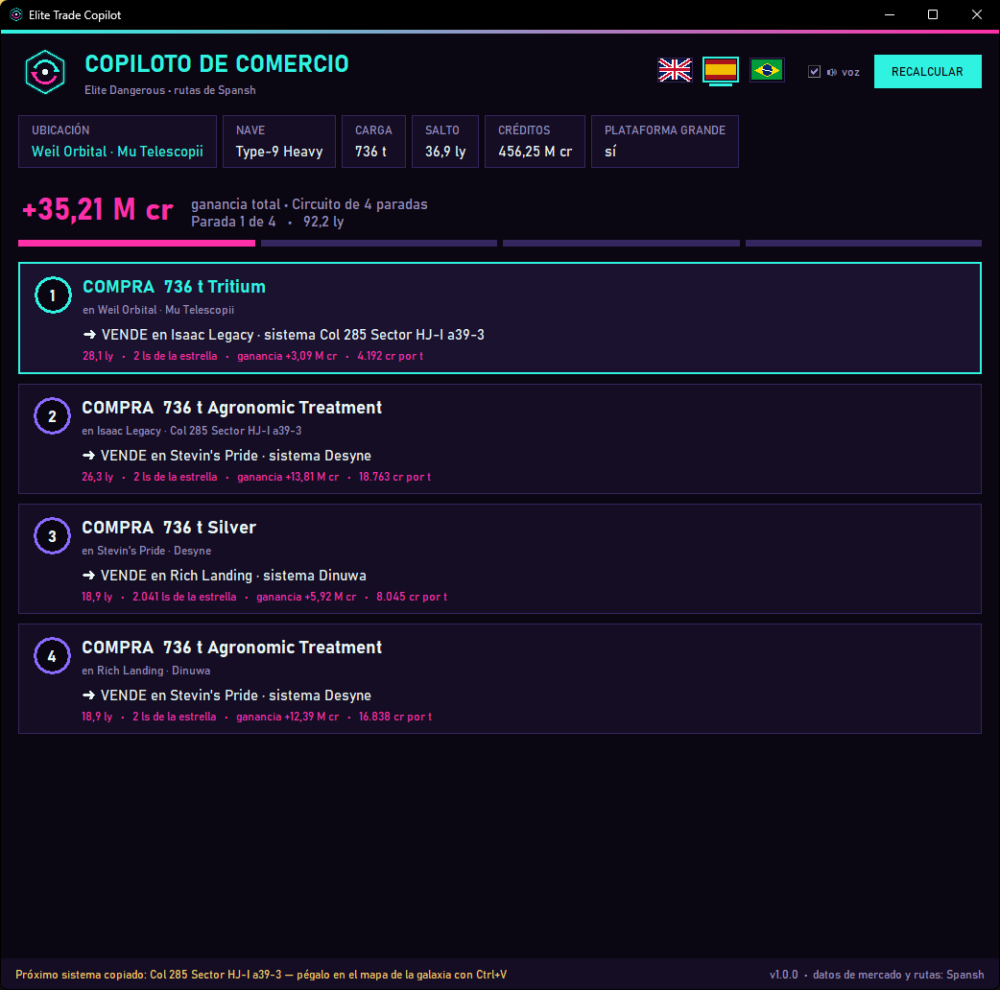

# ◈ Copiloto de Comercio — Elite Dangerous

[English](README.md) · [Português](README.pt-BR.md) · **Español**

Una pequeña ventana de apoyo para **Elite Dangerous** que te muestra, **automáticamente**, el circuito de comercio más rentable desde la estación donde acabas de atracar. Lee el diario del juego, consulta el planificador de comercio de [Spansh](https://spansh.co.uk/trade), muestra cada parada (qué comprar, dónde vender, distancia y ganancia), **lo dice en voz alta** y **copia el próximo sistema** al portapapeles para pegarlo directamente en el mapa de la galaxia.

## Qué hace

- **Sin escribir nada:** conoce tu sistema, estación, nave, capacidad de carga, alcance de salto y créditos gracias al diario del juego.
- **Recalcula cada vez que atracas**, sigue tu progreso en el circuito y rehace la ruta si te sales de ella.
- **Circuitos de varias paradas** (4 por defecto) con los datos de mercado de Spansh.
- **Avisos por voz** con las voces de Windows instaladas en tu PC.
- **Próximo sistema copiado:** abre el mapa de la galaxia, `Ctrl+V` y traza la ruta.
- **Idiomas:** español, inglés y portugués (Brasil), detectados automáticamente y seleccionables en la ventana.
- **Solo lectura y seguro:** no envía teclas al juego ni toca su memoria. Igual que EDMC o EDDI, solo lee los archivos de diario que el propio juego escribe para herramientas externas.

### Pestaña Ingresos: RevOps para tu comandante

Una segunda pestaña convierte tu comercio en un pequeño panel de ingresos, construido con las ventas que el juego ya registra en el diario (incluidas tus sesiones anteriores):

- **Ingresos de hoy, de la sesión y totales**, con el número de ventas.
- **Créditos por hora** en los últimos 7 días de juego.
- **Pipeline:** ganancia que falta realizar en el circuito actual.
- **Precisión del forecast:** realizado ÷ previsto en cada parada completada.
- **Gráfico de ingresos acumulados** (30 días), **mix de productos** por ganancia y margen y **últimas ventas**.

Todo queda en tu PC en un archivo pequeño, `data/revenue.json`: sin base de datos y sin cuenta.

## Requisitos

- Windows 10 u 11 (la voz y la conexión de respaldo usan componentes del propio Windows).
- [Python 3.10 o superior](https://www.python.org/downloads/). Durante la instalación marca **"Add python.exe to PATH"**. No hace falta instalar paquetes adicionales.
- Elite Dangerous (Horizons u Odyssey) en PC.
- Opcional, para la voz: una voz de Windows en tu idioma (Configuración → Hora e idioma → Voz → Agregar voces).

## Instalación

1. Descarga este repositorio: **Code → Download ZIP** y descomprímelo donde quieras (o `git clone https://github.com/andretena/elite-trade-copilot`).
2. Haz doble clic en **`run.bat`**. Se abre la ventana; colócala y ajústala donde quieras (un segundo monitor es ideal). Recuerda su posición.
3. Abre Elite Dangerous y atraca en cualquier estación con una nave que tenga bodega de carga.

## Cómo se usa

1. **Atraca.** El copiloto calcula un circuito desde esa estación y te dice qué comprar y adónde ir.
2. **Compra** la mercancía de la primera tarjeta.
3. Abre el **mapa de la galaxia**, pega (`Ctrl+V`) el nombre del sistema, traza la ruta y salta. Con Supercruise Assist y el Docking Computer avanzado, el vuelo es casi automático.
4. **Atraca en el destino.** La tarjeta se marca como hecha y se anuncia y copia la próxima parada.
5. Al terminar el circuito se calcula uno nuevo solo. **RECALCULAR** fuerza una nueva ruta cuando quieras.

## Configuración

El archivo `config.json` se crea junto a `copilot.py` en la primera ejecución:

| Clave | Por defecto | Significado |
|---|---|---|
| `language` | `auto` | `auto`, `en`, `pt-BR` o `es` |
| `max_hops` | `4` | Paradas del circuito |
| `max_hop_distance` | `30` | Distancia máxima (años luz) entre estaciones consecutivas |
| `max_system_distance` | `5000` | Distancia máxima (ls) desde la estrella de llegada |
| `max_price_age_hours` | `48` | Ignora datos de mercado más antiguos |
| `allow_planetary` | `false` | Incluir puertos planetarios |
| `allow_player_owned` | `false` | Incluir fleet carriers |
| `speak` | `true` | Avisos por voz |
| `copy_next_system` | `true` | Copiar el próximo sistema |
| `always_on_top` | `true` | Mantener la ventana encima de las demás |

## Añadir un idioma

Copia `locales/en.json` a `locales/<código>.json` (por ejemplo `fr.json`), traduce los textos y pon en `voice_culture` la cultura de una voz de Windows, como `fr-FR`. Aparece solo en el menú de idiomas. ¡Los pull requests son bienvenidos!

## Créditos y aviso

- Datos de comercio y planificación de rutas por **[Spansh](https://spansh.co.uk)**; considera apoyarlo en [Patreon](https://www.patreon.com/spansh). La herramienta hace una consulta por atraque; por favor no satures el servicio.
- Los datos de mercado vienen de jugadores que usan herramientas como EDMC, que los envían a EDDN.
- Sin relación con Frontier Developments. Elite Dangerous es una marca registrada de Frontier Developments plc.

## Licencia

[MIT](LICENSE)
