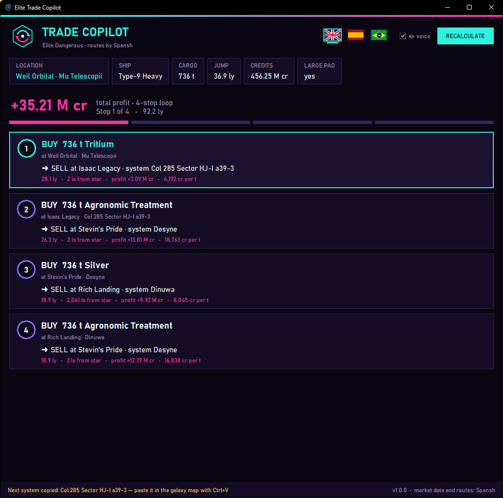

# ◈ Elite Trade Copilot

**English** · [Português](README.pt-BR.md) · [Español](README.es.md)

A small companion window for **Elite Dangerous** that tells you, **automatically**, the most profitable trade loop starting from the station you just docked at. It reads the game's journal, asks the [Spansh](https://spansh.co.uk/trade) trade planner, shows each stop (what to buy, where to sell, distance, profit), **reads it out loud**, and **copies the next system to your clipboard** so you can paste it straight into the galaxy map.

## Features

- **Zero typing** — knows your system, station, ship, cargo capacity, jump range and credits from the journal.
- **Recalculates every time you dock**, follows your progress through the loop, and re-plots if you go off-route.
- **Multi-stop loops** (4 stops by default) using Spansh market data.
- **Voice announcements** using the Windows voices installed on your PC.
- **Next system copied to clipboard** — open the galaxy map, `Ctrl+V`, plot.
- **Languages:** English, Português (Brasil), Español — detected automatically, switchable in the window.
- **Read-only and safe:** it never sends input to the game, never touches game memory. Like EDMC or EDDI, it only reads the journal files the game writes for third-party tools.

## Requirements

- Windows 10 or 11 (voice and the HTTPS fallback use built-in Windows components).
- [Python 3.10+](https://www.python.org/downloads/) — during setup tick **"Add python.exe to PATH"**. No extra packages needed.
- Elite Dangerous (Horizons or Odyssey) on PC.
- Optional, for voice: a Windows voice in your language (Settings → Time & language → Speech → Add voices).

## Install

1. Download this repository: **Code → Download ZIP** and extract it anywhere (or `git clone https://github.com/andretena/elite-trade-copilot`).
2. Double-click **`run.bat`**. The window opens; move/resize it where you like (a second monitor is perfect). Its position is remembered.
3. Launch Elite Dangerous and dock at any station with a ship that has cargo racks.

## How to use

1. **Dock.** The copilot plots a loop from that station and says what to buy and where to go.
2. **Buy** the commodity shown in the first card.
3. Open the **galaxy map**, paste (`Ctrl+V`) the system name, plot and jump. Supercruise Assist and an Advanced Docking Computer make the flight hands-off.
4. **Dock at the destination.** The card is marked done and the next stop is announced and copied.
5. At the end of the loop a new one is plotted automatically. **RECALCULATE** forces a new plot at any time.

## Settings

`config.json` is created next to `copilot.py` on first run:

| Key | Default | Meaning |
|---|---|---|
| `language` | `auto` | `auto`, `en`, `pt-BR` or `es` |
| `max_hops` | `4` | Stops in the loop |
| `max_hop_distance` | `30` | Max light-years between consecutive stations |
| `max_system_distance` | `5000` | Max distance (ls) from the arrival star |
| `max_price_age_hours` | `48` | Ignore market data older than this |
| `allow_planetary` | `false` | Include planetary ports |
| `allow_player_owned` | `false` | Include fleet carriers |
| `speak` | `true` | Voice announcements |
| `copy_next_system` | `true` | Copy the next system to the clipboard |
| `always_on_top` | `true` | Keep the window above other windows |

## Adding a language

Copy `locales/en.json` to `locales/<code>.json` (for example `fr.json`), translate the values, and set `voice_culture` to a Windows voice culture such as `fr-FR`. It shows up in the language menu automatically. Pull requests are welcome!

## Credits & disclaimer

- Trade data and route planning by **[Spansh](https://spansh.co.uk)** — please consider supporting it on [Patreon](https://www.patreon.com/spansh). This tool sends one request per dock; please don't hammer the service.
- Market data comes from players running tools such as EDMC that upload to EDDN.
- Not affiliated with or endorsed by Frontier Developments. Elite Dangerous is a trademark of Frontier Developments plc.

## License

[MIT](LICENSE)
