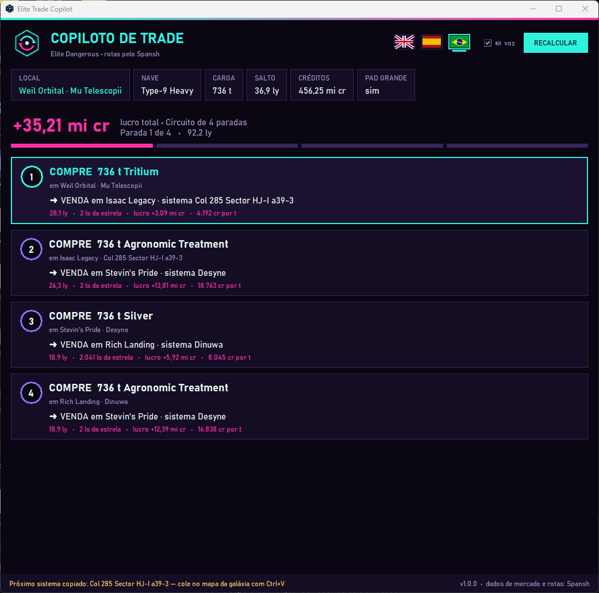
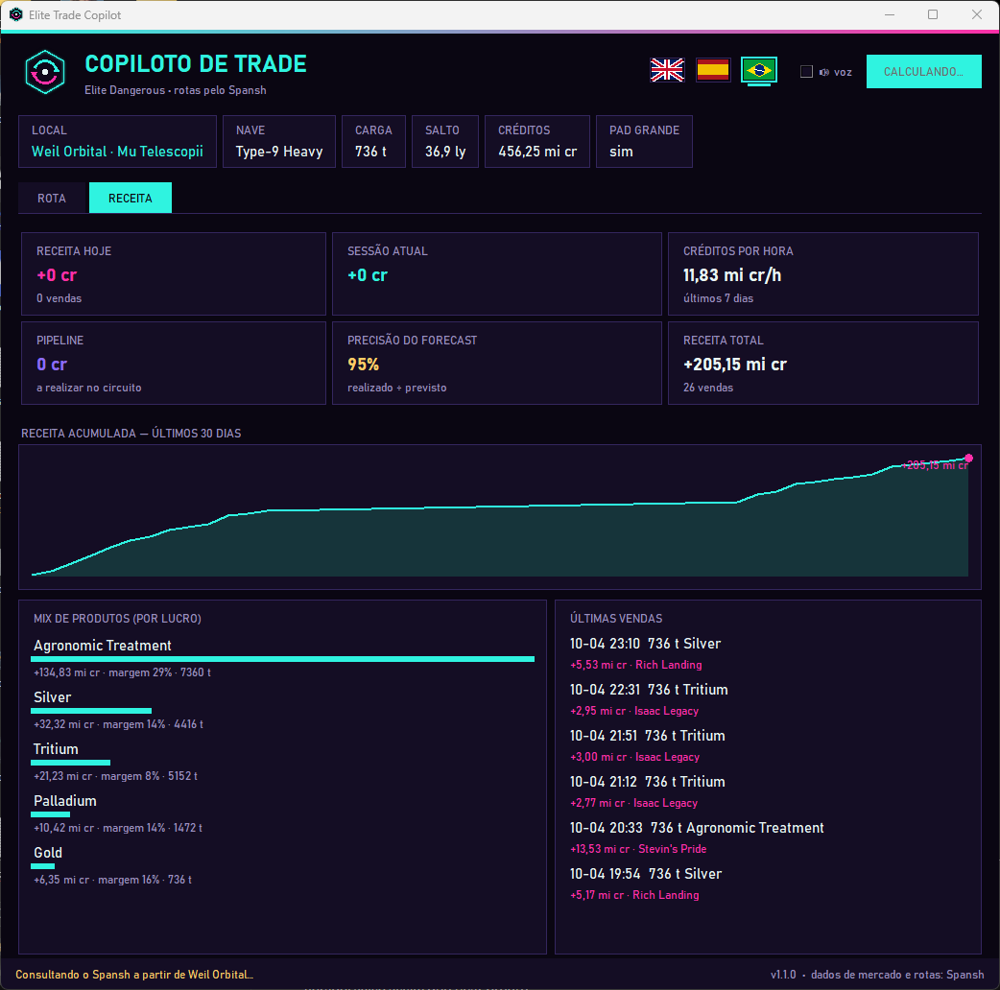

# ◈ Copiloto de Trade — Elite Dangerous

[English](README.md) · **Português** · [Español](README.es.md)

Uma janelinha de apoio para o **Elite Dangerous** que mostra, **sozinha**, o circuito de comércio mais lucrativo a partir da estação onde você acabou de atracar. Ela lê o diário do jogo, consulta o planejador de trade do [Spansh](https://spansh.co.uk/trade), mostra cada parada (o que comprar, onde vender, distância e lucro), **fala em voz alta** e **copia o próximo sistema** para você colar direto no mapa da galáxia.

## O que ele faz

- **Sem digitar nada:** sabe seu sistema, estação, nave, capacidade de carga, alcance de salto e créditos pelo diário do jogo.
- **Recalcula toda vez que você atraca**, acompanha seu progresso no circuito e refaz a rota se você sair dela.
- **Circuitos de várias paradas** (4 por padrão) com os dados de mercado do Spansh.
- **Avisos por voz** com as vozes do Windows instaladas no seu PC.
- **Próximo sistema copiado:** abra o mapa da galáxia, `Ctrl+V` e trace a rota.
- **Idiomas:** português (Brasil), inglês e espanhol, detectados automaticamente e trocáveis na janela.
- **Só leitura e seguro:** não aperta nada no jogo nem mexe na memória dele. Assim como o EDMC e o EDDI, só lê os arquivos de diário que o próprio jogo grava para ferramentas externas.

### Aba Receita: RevOps para o seu comandante

Uma segunda aba transforma seu comércio num pequeno painel de receita, montado com as vendas que o jogo já registra no diário (inclusive das sessões antigas):

- **Receita hoje, na sessão e total**, com o número de vendas.
- **Créditos por hora** nos últimos 7 dias de jogo.
- **Pipeline:** lucro que ainda falta realizar no circuito atual.
- **Precisão do forecast:** realizado ÷ previsto em cada parada concluída.
- **Gráfico de receita acumulada** (30 dias), **mix de produtos** por lucro e margem e **últimas vendas**.

Tudo fica no seu PC num arquivo pequeno, `data/revenue.json`: sem banco de dados e sem conta.

## Requisitos

- Windows 10 ou 11 (a voz e a rede de reserva usam componentes do próprio Windows).
- [Python 3.10 ou mais novo](https://www.python.org/downloads/). Na instalação, marque **"Add python.exe to PATH"**. Não precisa instalar pacotes extras.
- Elite Dangerous (Horizons ou Odyssey) no PC.
- Opcional, para a voz: uma voz do Windows no seu idioma (Configurações → Hora e idioma → Fala → Adicionar vozes).

## Instalação

1. Baixe este repositório: **Code → Download ZIP** e extraia onde quiser (ou `git clone https://github.com/andretena/elite-trade-copilot`).
2. Dê dois cliques em **`run.bat`**. A janela abre; posicione e redimensione onde quiser (um segundo monitor é perfeito). Ela lembra a posição.
3. Abra o Elite Dangerous e atraque em qualquer estação com uma nave que tenha compartimento de carga.

## Como usar

1. **Atraque.** O copiloto monta um circuito a partir daquela estação e fala o que comprar e para onde ir.
2. **Compre** a mercadoria do primeiro cartão.
3. Abra o **mapa da galáxia**, cole (`Ctrl+V`) o nome do sistema, trace a rota e salte. Com o Supercruise Assist e o Docking Computer avançado, o voo fica praticamente automático.
4. **Atraque no destino.** O cartão é marcado como feito, e a próxima parada é anunciada e copiada.
5. No fim do circuito, um novo é calculado sozinho. **RECALCULAR** força uma nova rota a qualquer momento.

## Configurações

O `config.json` é criado ao lado do `copilot.py` na primeira execução:

| Chave | Padrão | Significado |
|---|---|---|
| `language` | `auto` | `auto`, `en`, `pt-BR` ou `es` |
| `max_hops` | `4` | Paradas no circuito |
| `max_hop_distance` | `30` | Distância máxima (anos-luz) entre estações seguidas |
| `max_system_distance` | `5000` | Distância máxima (ls) da estrela de chegada |
| `max_price_age_hours` | `48` | Ignora dados de mercado mais velhos que isso |
| `allow_planetary` | `false` | Inclui portos em planetas |
| `allow_player_owned` | `false` | Inclui fleet carriers |
| `speak` | `true` | Avisos por voz |
| `copy_next_system` | `true` | Copia o próximo sistema |
| `always_on_top` | `true` | Mantém a janela por cima das outras |

## Adicionar um idioma

Copie `locales/en.json` para `locales/<código>.json` (por exemplo `fr.json`), traduza os textos e coloque em `voice_culture` a cultura de uma voz do Windows, como `fr-FR`. O idioma aparece sozinho no menu. Pull requests são bem-vindos!

## Créditos e aviso

- Dados de comércio e planejamento de rotas pelo **[Spansh](https://spansh.co.uk)**. Considere apoiar no [Patreon](https://www.patreon.com/spansh). A ferramenta faz uma consulta por atracada; não sobrecarregue o serviço.
- Os dados de mercado vêm de jogadores que usam ferramentas como o EDMC, que enviam ao EDDN.
- Sem vínculo com a Frontier Developments. Elite Dangerous é marca registrada da Frontier Developments plc.

## Licença

[MIT](LICENSE)
